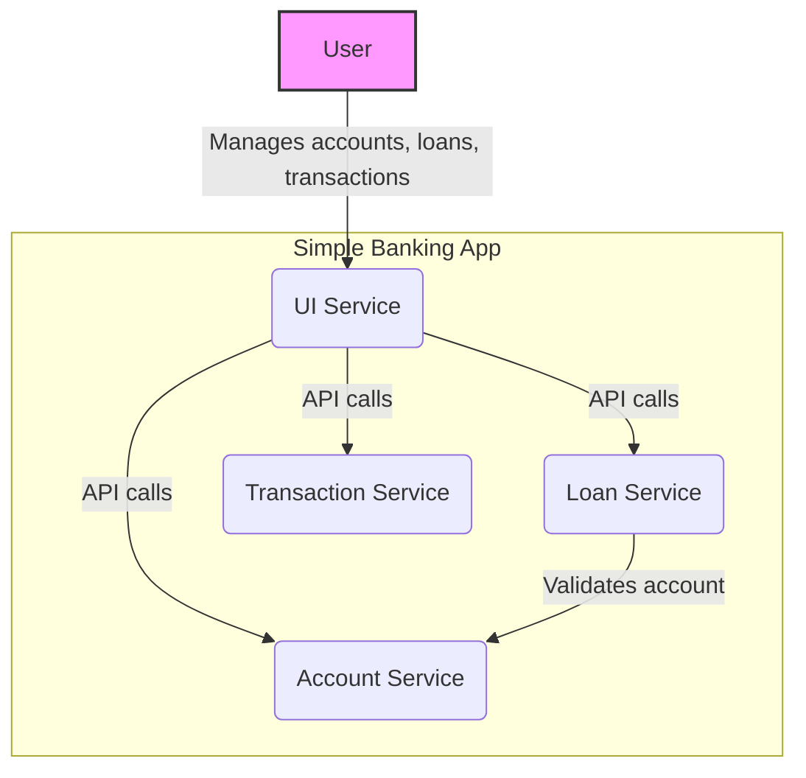

# Simple Banking App Architecture

This document provides a comprehensive overview of the Simple Banking App's architecture, outlining its services, their interactions, and the overall system design. This application is designed as a set of loosely coupled microservices, each responsible for a specific business domain.

## System Overview

The application is composed of the following four services:

- **UI Service**: A web-based user interface that acts as the primary entry point for all user interactions.
- **Account Service**: Manages user accounts, including creation, retrieval, and updates.
- **Loan Service**: Handles loan requests, validating them against existing accounts.
- **Transaction Service**: Records all financial transactions, such as deposits and withdrawals.

All services are containerized using Docker and orchestrated via a single `docker-compose.yml` file, making the development and deployment processes streamlined and consistent.

## Architecture Diagram

The following diagram illustrates the high-level architecture of the system, showing how users and services interact.



## Service Details

Each service is a self-contained Node.js application built with the Express framework. Below is a detailed description of each one.

### 1. UI Service

- **Port**: `3000`
- **Description**: This service provides a static web interface that allows users to interact with the banking system. From this UI, users can create accounts, request loans, and record transactions. It makes API calls to the backend services to perform these operations.

### 2. Account Service

- **Port**: `3001`
- **Description**: The Account Service is responsible for all account-related operations. It exposes a RESTful API to create, read, and update user accounts. The service maintains an in-memory database of accounts, each with a unique ID, name, and balance.

### 3. Loan Service

- **Port**: `3002`
- **Description**: This service manages loan requests. When a user requests a loan, this service communicates with the **Account Service** to verify that the specified account exists before approving the loan. This inter-service communication is a key aspect of the microservices architecture.

### 4. Transaction Service

- **Port**: `3003`
- **Description**: The Transaction Service is responsible for recording financial transactions. It provides an API to create and retrieve transactions, each linked to a specific account. All records are stored in memory.

## How to Run the Application

To run the application, ensure you have Docker and Docker Compose installed, then follow these steps:

1. **Clone the repository**:
   ```sh
   git clone <repository-url>
   cd simple-banking-app
   ```
2. **Build and run the services**:
   ```sh
   docker-compose up --build
   ```
3. **Access the UI**:
   Once the services are running, open your web browser and navigate to `http://localhost:3000` to access the application.

The services will be available at their respective ports:
- **UI**: `http://localhost:3000`
- **Account**: `http://localhost:3001`
- **Loan**: `http://localhost:3002`
- **Transaction**: `http://localhost:3003`
